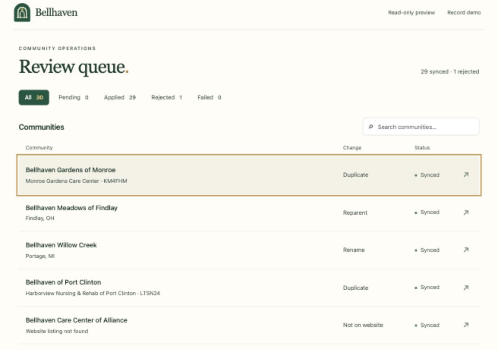

# Bellhaven CRM Review

Reconcile a senior-living website with CRM accounts through an evidence-based approval workflow. Discovery proposes changes; a reviewer approves or rejects each one before any CRM write.



## Start here

- **Try the app:** follow the quick start below.
- **Review the outcome:** [verified CRM results](docs/results.md).
- **Understand the logic:** [matching, billing safeguards, and tradeoffs](docs/approach.md).

## Quick start

Requires **Python 3.10+**, macOS or Linux, and `unzip`. From the project directory:

```sh
# Restore the completed fictional example; existing files are not overwritten.
unzip -n examples/completed-review.zip -d .
./start.sh
```

Open **http://127.0.0.1:8765/**. The example needs no API token and starts in read-only mode. The launcher creates `.venv` and installs pinned dependencies.

For a fresh sandbox run, skip example extraction and supply `BELLHAVEN_API_TOKEN` before starting. See [operations](docs/operations.md) for discovery, approval writes, scheduling, and recovery. Keep your existing review ledger across daily runs.

## Verified outcome

The November 4, 2026 reconciliation covered **35 website communities**: **29 proposals applied**, **1 rejected**, and **0 pending or failed**. A repeat run added **0 proposals**. All original revenue and receivables were preserved.

[Decision details and evidence](docs/results.md) explain the six new accounts, duplicate handling, protected ownership changes, and rejected billing-address correction.

## Repository guide

| Location | Contents |
| --- | --- |
| `discover.py`, `reconcile.py`, `daily.py` | Crawl, match, and refresh proposals |
| `review.py`, `web/`, `start.sh` | Local review application and launcher |
| `verify.py`, `tests/` | Read-back audit and automated checks |
| [config/](config/) | Daily cron example; not installed |
| [docs/](docs/operations.md) | Operations, approach, and results |
| [examples/](examples/README.md) | Completed fictional review evidence |

## Validation

```sh
.venv/bin/python -m unittest discover -s tests -v
```

**34 tests passed.** Tests use isolated fixtures and do not mutate the live CRM. See [validation details](docs/operations.md#schedule-and-validation).

API credentials are never included in the repository. The application is intended for local use. [AI assistance and design references](docs/approach.md#ai-assistance) are documented explicitly.
